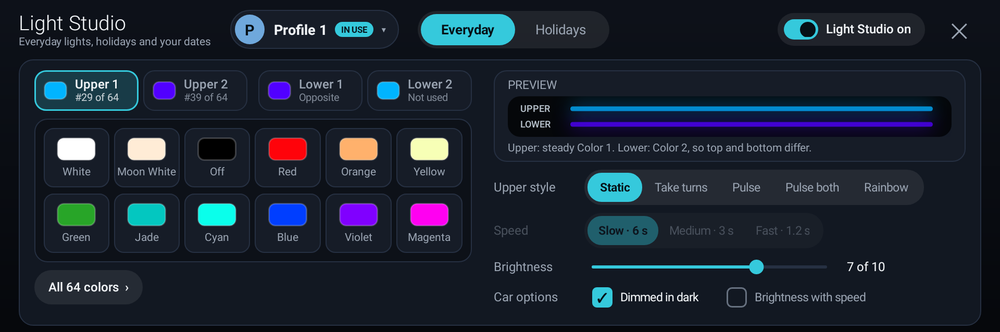
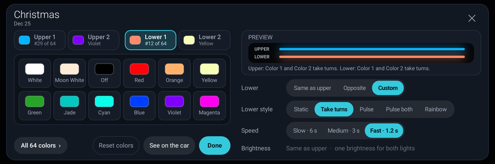
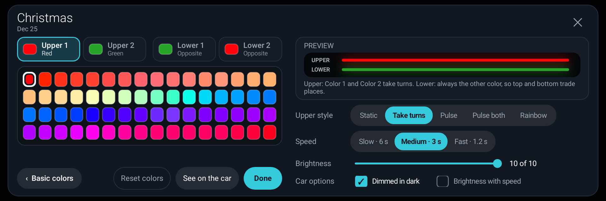
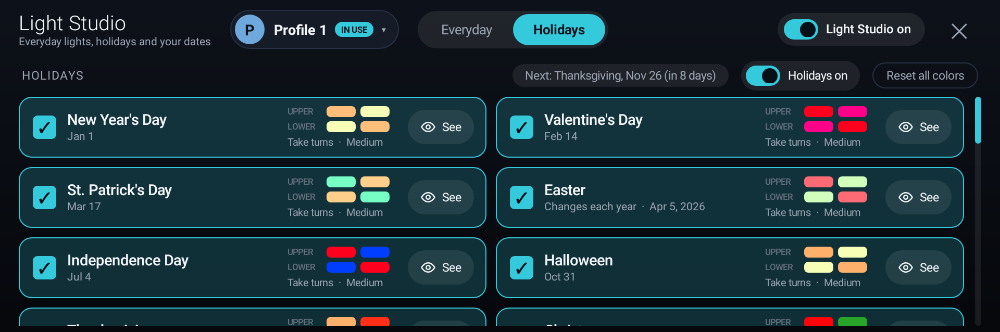

# Gen5W Light Studio

An [HMG-API](https://github.com/Open-HMG/HMG-API) mod that runs your car's ambient lights: an Everyday light of your own, plus the holidays and three dates of yours that take over on their day. The upper and lower lights each get their own colors and style. On the car it's called **Light Studio**.

By DeFlight, LLC.

> [!IMPORTANT]
> **Tested on the Hyundai Ioniq 6 only.** Light Studio drives the two-zone ambient light (upper and lower) of a Gen5W head unit. Other cars may work; see [Compatibility](#compatibility).

## Contents

- [Light Studio on / off](#light-studio-on--off)
- [The two lights](#the-two-lights)
- [Styles](#styles)
- [Colors](#colors)
- [Brightness and the car's options](#brightness-and-the-cars-options)
- [Holidays and My Dates](#holidays-and-my-dates)
- [Profiles](#profiles)
- [Good to know](#good-to-know)
- [Requirements](#requirements) · [Compatibility](#compatibility) · [Install](#install)
- [Support](#support)

## Light Studio on / off

The switch at the top right.

- **On:** Light Studio drives both lights. Changes made in the car's own light settings are put back within 10 seconds.
- **Off:** the screen says the car's own settings are in charge, and the car's light settings come back exactly as they were before Light Studio took over (colors, brightness, Dimmed in dark, Brightness with speed and the drive-mode link). Your Light Studio settings are kept for when you turn it back on.

## The two lights

The car has two separate light strips, the **upper** and the **lower**. The four tabs at the top of the page pick what you're changing: **Upper 1** and **Upper 2** (the upper light's Color 1 and Color 2), **Lower 1** and **Lower 2**.

On a Lower tab, **Lower** sets what the lower light does:

| Choice | What the lower light shows |
|---|---|
| **Same as upper** | Exactly what the upper light shows, at the same moment. |
| **Opposite** | The upper light's other color. With Static, the upper shows Color 1 and the lower Color 2. With Take turns they trade, so top and bottom never match. With Rainbow, the same rainbow half way round. |
| **Custom** | Its own Color 1, Color 2, style and speed. |

The preview shows both lights, labelled **UPPER** and **LOWER**, and the line under it says what each is doing.

## Styles

| Style | What it does |
|---|---|
| **Static** | Color 1, steady. |
| **Take turns** | Switches between Color 1 and Color 2. |
| **Pulse** | Color 1, dimming down to off and back up. |
| **Pulse both** | Dims to off, switches color while dark, and comes back up in the other color. |
| **Rainbow** | Runs through all 64 of the car's colors, over and over. No colors to pick. |

**Speed** is how long one cycle takes: Slow 6 s, Medium 3 s, Fast 1.2 s. For Rainbow it's one trip around all the colors: Slow 60 s, Medium 20 s, Fast 6 s.

## Colors

- **Basic colors:** White, Moon White, Off, Red, Orange, Yellow, Green, Jade, Cyan, Blue, Violet and Magenta. White, Moon White, Green and Jade are the car's own presets (Polar White, Moon White, Orchid Green, Jade Green).
- **Off** turns the lights off (brightness 0). Picking a color afterwards turns them back on.
- **All 64 colors** shows every color on the car's own color wheel.

The car shows only its 64 wheel colors and its own presets. Any other color is ignored by the car, so there's no custom RGB or fade between colors. On screen the swatches are brighter than in the cabin, and neighbouring colors can look alike in the car. Pick colors further apart for a clear difference.

## Brightness and the car's options

These are on the Upper tabs. The car has one brightness for both lights, so a Lower tab shows **Same as upper**.

- **Brightness:** 0 (off) to 10. When either light pulses, both dim together.
- **Dimmed in dark:** the car dims the lights at night, as in its own settings. On by default.
- **Brightness with speed:** the car sets the brightness by your speed, as in its own settings. While it's on, the slider is greyed out and reads **Car sets it**. Off by default.

Everyday, each holiday and each My Date has its own brightness and options.

## Holidays and My Dates

- **Nine holidays:** New Year's Day, Valentine's Day, St. Patrick's Day, Easter, Independence Day, Halloween, Thanksgiving, Christmas and New Year's Eve. Easter and Thanksgiving move each year. Tap a card to change its lights; the checkbox turns that holiday on or off.
- **Three My Dates** you name and date yourself. A My Date wins over a holiday on the same day.
- **On the day,** that day's lights take over and stay all day. The next day your Everyday light comes back.
- **Back to everyday lights today** (on the Everyday page, on a holiday) skips today's lights.
- **Holidays on / off** turns all holidays and My Dates off at once, and your Everyday light stays on every day.
- **Reset all colors** puts the holidays' colors, styles, speed and brightness back to the defaults. My Dates are left alone, and so are the lower lights of a holiday set to Custom.
- **See** shows a holiday or My Date on the car for 30 seconds, then your lights come back.

## Profiles

Each of the car's profiles (Profile 1, Profile 2 and Guest) has its own lights: Everyday, holidays and My Dates. The chip next to the title shows the profile you're editing, with its name and picture from the car. **IN USE** marks the profile the car is on now. Tap the chip to edit another profile. When the car switches profile, that profile's lights take over.

## Good to know

- **The car's own light settings** don't do anything while Light Studio is on. Light Studio puts its own lights back within 10 seconds.
- **Link to drive mode** (the car's option that colors the lights by drive mode) is turned off while Light Studio is on, because the car shows custom colors only with it off. It comes back when Light Studio is turned off.
- **Removing the mod** or turning it off in the HMG-API app puts the car's own light settings back first.
- **If the car is switched off** while Light Studio is on, your own car settings are still kept, so they are what come back when Light Studio is turned off.
- **Settings** are kept by HMG-API and changed only on the Light Studio screen. They aren't on the mod's page in the HMG-API app.

## Requirements

- A car with a **Gen5W** navigation head unit, the head unit HMG-API supports, and a two-zone ambient light (upper and lower).
- **[HMG-API](https://github.com/Open-HMG/HMG-API)** installed ([Installing HMG-API](https://github.com/Open-HMG/HMG-API/wiki/Installing-HMG-API)). After a car firmware update, HMG-API has to be installed again.
- No hook map is needed: Light Studio uses the same light calls as the car's own settings.

## Compatibility

**Tested:**

| Car | Firmware | HMG-API |
|---|---|---|
| 2025 Hyundai Ioniq 6 Limited (US) | CEEV.USA.0000.V015.012.260507 | 1.1.0-rc.4 |

**May work** on other Gen5W cars with the same two-zone ambient light, if their light uses the same calls and colors. This hasn't been tested.

Tried it on another car, or something doesn't work? Please [open an issue](../../issues/new?template=car-report.yml). The form asks for your car and its software, the versions, what you set and what the lights did, and a screenshot of the Light Studio log from the HMG-API app.

## Install

Install [HMG-API](https://github.com/Open-HMG/HMG-API/wiki/Installing-HMG-API) first. Then download one of these from [Releases](../../releases):

| File | For |
|---|---|
| `gen5w-light-studio-v<version>-hmgapi-usb.zip` | installing from the HMG-API app with a USB drive |
| `gen5w-light-studio-v<version>-nemesis-usb.zip` | installing from NEMESIS with a USB drive |
| `gen5w-light-studio-v<version>-nemesis-package.zip` | the NEMESIS package itself, for the Package Store or `nemesis install`. Not for unzipping onto a drive |
| `gen5w-light-studio-v<version>.zip` | the signed mod on its own |

### With the HMG-API app

1. Unzip `gen5w-light-studio-v<version>-hmgapi-usb.zip` onto the top level of a FAT32 or exFAT USB drive, so the drive has `HMGAPI/updates/gen5w-light-studio-v<version>.zip`.
2. Plug the drive into the car and install the mod from the updates page in the HMG-API app.
3. Tap **Apply changes**.

To remove it, use **Remove** on Gen5W Light Studio in the HMG-API app.

### With NEMESIS

1. Unzip `gen5w-light-studio-v<version>-nemesis-usb.zip` onto the top level of a FAT32 or exFAT USB drive, so the drive has `NEMESIS.data` and the `packages` folder at its top level. Keep only one NEMESIS package on the drive.
2. Once Android is up, plug the drive into the car and confirm the install of "Gen5W Light Studio".
3. Restart the head unit if it asks, then take the drive out.

HMG-API installs and applies the mod for you. To remove it, uninstall the package in NEMESIS Manager.

### After installing

1. **Restart the head unit**, so the **Light Studio** tile shows up in the app menu.
2. Open **Light Studio** and set your Everyday light. Light Studio starts on.

Updates install the same way and keep your settings.

## How it works

- **The screen** (the Light Studio app) saves your choices to HMG-API's settings for the mod.
- **The engine** is a small service HMG-API runs as root. Once a second it reads those settings and works out what to show: a See preview, today's My Date or holiday, or Everyday, for the car's current profile. It then drives the lights with the same calls the car's own settings use:
  - the upper light's color (`setSMLRGB`) and the lower light's color (`setDualLightALL`);
  - two-color or one-color mode, Brightness with speed, brightness, Dimmed in dark and the drive-mode link.
- **Presets** (Polar White, Moon White, Orchid Green, Jade Green) are sent with 256 added to each value, the way the car's own settings send them.
- **Before it first changes the lights,** the engine keeps the car's own light settings. Turning Light Studio off, turning the mod off or removing it sends them back.

## Building

`gen5w-light-studio/build.sh` builds the app, the engine and all the release files into `gen5w-light-studio/out/`. It needs JDK 8 to 17, Android build-tools, an API 19 `android.jar`, HMG-API's mod SDK, and your own signing keys; the variables are listed at the top of the script. A build signed with a different author key installs as a different author, so it can't update an install of the official release.

## Support

Gen5W Light Studio is free. If it's useful to you, you can leave a tip to support DeFlight's work on it and future mods: **[paypal.me/deflight](https://paypal.me/deflight)**. Tips are optional and don't unlock anything.

## Credits

- [Open-HMG/HMG-API](https://github.com/Open-HMG/HMG-API), the mod platform this runs on.
- [Light Vibes](https://github.com/dibble9012/light-vibes) showed which calls drive the Gen5W ambient light and listed the car's 64 colors. Light Studio uses the car's own color values (also in the car's settings app) and contains no code from Light Vibes.

## Disclaimer

Not affiliated with or endorsed by Hyundai, Kia or Genesis. Modifying your car's head unit is at your own risk.

## License

MIT, see [LICENSE](LICENSE).
